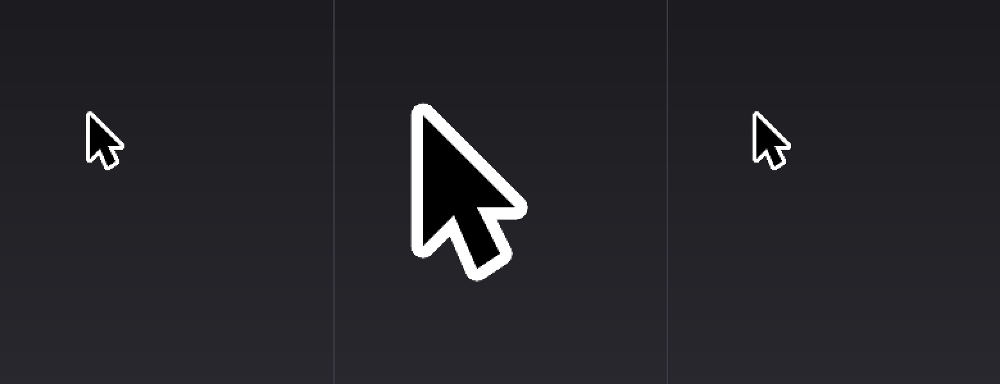

# 摇一摇找鼠标（Windows）

**把 macOS 的「晃鼠标 → 指针变大」搬到 Windows 10/11。**

4K 屏、多显示器上找不到鼠标指针？抓起鼠标晃两下——指针会变成一只**实心、放大 3 倍的大箭头**，
停留一会儿再缩回原样。

仅支持 Windows，需要 Python 3.8+，**零第三方依赖**（纯 `ctypes` 调 Win32，不需要 `pip install`）。

左 → 中 → 右：正常指针、晃一下后的放大指针、约 1 秒后恢复原样。

---

## 为什么做这个

macOS 一直有这个功能。Windows 的「辅助功能 → 鼠标指针大小」只能全局永久放大，
意味着指针在**任何时候**都是巨大的。这个工具只在**你需要的时候**放大一下。

## 快速开始

1. Windows 10 或 11，装好 Python 3.8+（安装时勾选 **Add python.exe to PATH**）
2. 下载本仓库（`Code → Download ZIP`）或 `git clone`
3. 双击 **`start.bat`**
4. 晃动鼠标

不用安装、不用管理员权限、不注册服务。要退出按 `Ctrl + Alt + Q`，或双击 `stop.bat`。

| 文件 | 作用 |
| --- | --- |
| `start.bat` | 后台启动（无控制台窗口） |
| `start-debug.bat` | 带控制台启动，会打印每一次识别到的晃动 |
| `stop.bat` | 退出，并强制还原系统鼠标指针 |
| `autostart-on.bat` | 开启登录自启（仅当前用户，无需管理员） |
| `autostart-off.bat` | 关闭登录自启 |
| `shake_cursor.pyw` | 程序本体 |

## 热键

| 按键 | 作用 |
| --- | --- |
| *晃动鼠标* | 放大指针 |
| `Ctrl + Alt + Space` | 手动触发一次 |
| `Ctrl + Alt + Q` | 退出 |

## 怎么判断你在「晃」

不是简单的位移阈值。两个轴各跑一个小状态机，统计**净位移**和**折返次数**：

- 一次折返前的那一程至少要 `SHAKE_MIN_RUN`（14px）才算数
- 0.6 秒内要有 **3 次折返**（约来回晃 1.5 个来回）
- 实际体感：认真晃一下，**0.3 秒左右**就触发

所以缓慢拖动、画圈、手抖、慢慢来回荡**都不会**误触发。

## 参数调整

打开 `shake_cursor.pyw`，常量都在文件开头：

| 常量 | 默认 | 含义 |
| --- | --- | --- |
| `PEAK_SCALE` | `3.0` | 放大倍数 |
| `GROW_SEC` | `0.13` | 放大耗时 |
| `HOLD_SEC` | `0.72` | 保持大号的时长 |
| `SHRINK_SEC` | `0.26` | 缩回耗时 |
| `SHAKE_MIN_RUN` | `14` | 单程最小位移（px），调大 = 更难触发 |
| `SHAKE_WINDOW` | `0.60` | 折返统计时间窗（秒） |
| `SHAKE_REVERSALS` | `3` | 时间窗内需要的折返次数 |
| `HIDE_SYSTEM_CUR` | `True` | 放大时是否隐藏真指针（见下文） |
| `OUTLINE_RATIO` | `0.08` | 白描边粗细（相对箭头高度） |

改完保存，退出程序重新启动生效。

## 实现原理

1. **识别** —— 以约 125Hz 轮询 `GetCursorPos`，把位移喂给两个逐轴折返计数器（见上）。
2. **隐藏真指针** —— 用 `CreateIconIndirect` 造一个全透明光标，再用
   `SetSystemCursor(OCR_NORMAL)` 临时替换系统箭头。**只替换普通箭头**，I 型光标和手型光标不受影响。
3. **画放大的指针** —— 一个 `WS_EX_LAYERED` 的点击穿透窗口，用 `UpdateLayeredWindow`
   做逐像素 alpha 合成。箭头是经典多边形，用 GDI 在 **4 倍超采样**下填充、再
   `StretchBlt(HALFTONE)` 降采样，所以边缘干净不糊。21 个尺寸在启动时一次性预渲染
   （约 30ms），动画时只换帧并跟随鼠标。
4. **安全兜底** —— `SetSystemCursor` 最坏的后果是「指针一直看不见」。所以程序会拉起一个
   极小的**看门狗子进程**，阻塞在 stdin 管道上：主进程无论因为什么原因退出（正常退出、
   崩溃、被任务管理器强杀），管道一断，看门狗立刻 `SystemParametersInfo(SPI_SETCURSORS)`
   把指针还原。`stop.bat` 是额外的手动开关。

## 常见问题

**鼠标指针不见了/看不见了。** 双击 `stop.bat`，即使程序没在运行它也能还原系统指针。

**晃了没反应。** 用 `start-debug.bat` 启动，看控制台输出：每次识别到晃动都会打印坐标。
如果一直只有 "running" 没有触发，晃得再快一点/幅度再大一点，或者调小
`SHAKE_MIN_RUN` / `SHAKE_REVERSALS`。

**提示找不到 Python。** 去 [python.org](https://www.python.org/downloads/) 装 3.8+，
安装时勾选 "Add python.exe to PATH"。

**会不会同时跑起来两份？** 不会。程序持有命名互斥量，第二个实例会直接退出。

**改了代码没生效。** 正在运行的实例内存里还是旧代码，`Ctrl + Alt + Q` 退出后重新启动。

## 已知限制

- 只替换**普通箭头**。指针停在输入框（I 型）或链接（手型）上时，系统光标保持原形，
  这时会看到大箭头出现在旁边。这是有意的取舍——不去掩盖指针当前的含义。
- 独占全屏的游戏、以及自绘/缓存光标的程序里，叠加窗口可能不显示。
- 仅 Windows。macOS 自带此功能；Linux 需要合成器层面的实现。

## 许可证

[MIT](LICENSE)，随便用、随便改、随便发布。
